## Hi, I'm Manoj

I'm a full stack developer with professional experience building web apps, mobile apps and the back ends behind them. On the server I mostly use Java with Spring Boot or Node.js, and React or React Native in front.

I take freelance work, and I'm happy to hear about good opportunities.

## What I can help you with

- A complete product: web app, mobile app, API and admin panel
- Back end work: REST APIs, microservices, databases, payments, live chat and notifications
- Front end work in React and React Native
- Taking over an existing project to fix bugs, add features or move it to a newer stack

## Featured work

### Full stack

<table>
<tr>
<td width="50%" valign="top"> <b><a href="https://github.com/immanoj22/trevolt">Trevolt</a></b> Forex trading demo: React web app, React Native app, Node and SQLite back end, admin panel.</td>
<td width="50%" valign="top"> <b><a href="https://github.com/immanoj22/meetwave-app">Meetwave</a></b> Hobby-based social app: React Native, Node and MongoDB, live chat, React admin panel. Team project.</td>
</tr>
<tr>
<td width="50%" valign="top"> <b><a href="https://github.com/immanoj22/ebook-converter">ebook-converter</a></b> Turns PDF books into DocBook, EPUB and other formats, with a web app to review the result.</td>
<td width="50%" valign="top"> <b><a href="https://github.com/immanoj22/E-commerce">E-commerce</a></b> Online shop with a React front end and a Spring Boot and PostgreSQL API.</td>
</tr>
</table>

   

### Back end

**[ride-hailing-backend](https://github.com/immanoj22/ride-hailing-backend)**: cab booking platform as eight Spring Boot services with PostgreSQL, Redis, RabbitMQ and Socket.IO.

**[betting-platform-backend](https://github.com/immanoj22/betting-platform-backend)**: game and wallet services for a betting site in Node, MongoDB and Redis. Team project.

**[springboot-microservices](https://github.com/immanoj22/springboot-microservices)**: service registry, API gateway and a JWT auth service.

**[User authentication](https://github.com/immanoj22/User-authentication-using-spring-security)**: sign-up and login with Spring Security and JWT.

More smaller projects, including [employee management](https://github.com/immanoj22/Employe-management) and [Spring AI](https://github.com/immanoj22/springAI-Learning), are in my repositories.

## Tools I use

| | |
|---|---|
| Back end | Java, Spring Boot, Spring Security, Node.js, Express |
| Front end | React, React Native, Redux, JavaScript, HTML, CSS |
| Data | PostgreSQL, MongoDB, Redis, SQLite |
| Messaging and live updates | RabbitMQ, Kafka, Socket.IO, WebSocket |
| Delivery | Docker, Jenkins, Git |

## Get in touch

Tell me what you're building and where you're stuck.

- Email: [s.manojraj193@gmail.com](mailto:s.manojraj193@gmail.com)
- Phone: +91 90945 81906
- LinkedIn: [linkedin.com/in/manojs22](https://www.linkedin.com/in/manojs22)
