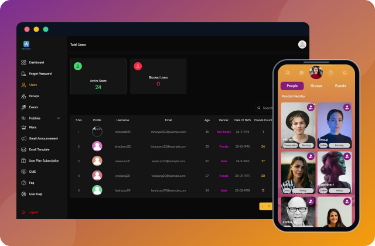

I'm a full stack developer with professional experience building web apps, mobile apps and the back ends behind them. On the server I mostly use Java with Spring Boot, or Node.js. On the front end I use React for the web and React Native for phones.

I take on freelance projects, and I'm happy to hear about good opportunities.

<table>
<tr>
<td width="50%" valign="top"> <b><a href="https://github.com/immanoj22/trevolt">Trevolt</a></b> Forex trading demo: React web app, React Native app, Node and SQLite back end, admin panel.</td>
<td width="50%" valign="top"> <b><a href="https://github.com/immanoj22/meetwave-app">Meetwave</a></b> Social app for meeting people through hobbies: React Native, Node and MongoDB, live chat, React admin panel. Team project.</td>
</tr>
<tr>
<td width="50%" valign="top"> <b><a href="https://github.com/immanoj22/ebook-converter">ebook-converter</a></b> Turns PDF books into DocBook, EPUB and other formats, with a web app to review the result.</td>
<td width="50%" valign="top"> <b><a href="https://github.com/immanoj22/E-commerce">E-commerce</a></b> Online shop with a React front end and a Spring Boot and PostgreSQL API.</td>
</tr>
</table>

<table>
<tr>
<td width="50%" valign="top"> <b><a href="https://github.com/immanoj22/ride-hailing-backend">ride-hailing-backend</a></b> Cab booking platform: eight Spring Boot services with PostgreSQL, Redis, RabbitMQ and Socket.IO.</td>
<td width="50%" valign="top"> <b><a href="https://github.com/immanoj22/betting-platform-backend">betting-platform-backend</a></b> Game and wallet services for a betting site in Node, MongoDB and Redis. Team project.</td>
</tr>
<tr>
<td width="50%" valign="top"> <b><a href="https://github.com/immanoj22/springboot-microservices">springboot-microservices</a></b> Service registry, API gateway and a JWT auth service.</td>
<td width="50%" valign="top"> <b><a href="https://github.com/immanoj22/User-authentication-using-spring-security">User authentication</a></b> Sign-up and login with Spring Security and JWT.</td>
</tr>
</table>

More projects, including [employee management](https://github.com/immanoj22/Employe-management) and [Spring AI](https://github.com/immanoj22/springAI-Learning), are in my [repositories](https://github.com/immanoj22?tab=repositories).

Tell me what you're building and where you're stuck. I'll reply with how I'd approach it.

