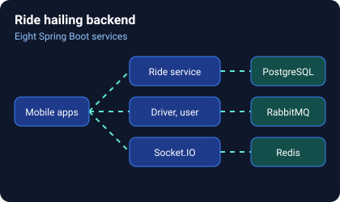
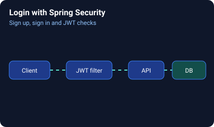

I'm a full stack developer. I build back ends mainly with Java and Spring Boot, and also with Node.js and Express. For the front end I use React. I also handle deployment with Docker, Jenkins and AWS, and can build mobile apps with React Native when a project needs one.

I take on freelance projects, and I'm happy to hear about good opportunities.

<table>
<tr>
  <td width="50%" valign="top"> <b><a href="https://github.com/immanoj22/trevolt">Trevolt</a></b> A trading platform where people follow live currency prices, place and close trades, and track their wallet and profit. Admins manage users, deposits and markets.</td>

  <td width="50%" valign="top"> <b><a href="https://github.com/immanoj22/meetwave-app">Meetwave</a></b> Helps people find others nearby who share their hobbies, join groups, go to local events and chat. Admins moderate users, groups and events. Team project.</td>
  
</tr>
<tr>
<td width="50%" valign="top"> <b><a href="https://github.com/immanoj22/ebook-converter">ebook-converter</a></b> Turns PDF books into e-books ready for publishers. An editor checks each page next to the original and fixes anything the converter got wrong before export.</td>

  
<td width="50%" valign="top"> <b><a href="https://github.com/immanoj22/E-commerce">E-commerce</a></b> An online store where shoppers browse by category, search and fill a cart, and sellers add and edit their own products. Spring Boot and React.</td>

</tr>
</table>

<table>
<tr>
<td width="50%" valign="top"> <b><a href="https://github.com/immanoj22/ride-hailing-backend">ride-hailing-backend</a></b> The server side of a cab booking app. Riders book trips, drivers accept them, both follow the ride live, then pay, rate and get support.</td>
<td width="50%" valign="top"> <b><a href="https://github.com/immanoj22/springboot-microservices">springboot-microservices</a></b> A user system split into small services, with sign-up, login and profile updates, and a gateway that checks every request first.</td>
</tr>
<tr>
<td width="50%" valign="top"> <b><a href="https://github.com/immanoj22/User-authentication-using-spring-security">User authentication</a></b> Lets people create an account and log in, and checks their login on every request after that.</td>
<td width="50%" valign="top"> <b><a href="https://github.com/immanoj22/betting-platform-backend">betting-platform-backend</a></b> The server side of an online betting site. Players sign in, keep a balance, play live game rounds and claim rewards. Team project.</td>
</tr>
</table>

More projects, including [employee management](https://github.com/immanoj22/Employe-management) and [Spring AI](https://github.com/immanoj22/springAI-Learning), are in my [repositories](https://github.com/immanoj22?tab=repositories).

Tell me what you're building and where you're stuck. I'll reply with how I'd approach it.

